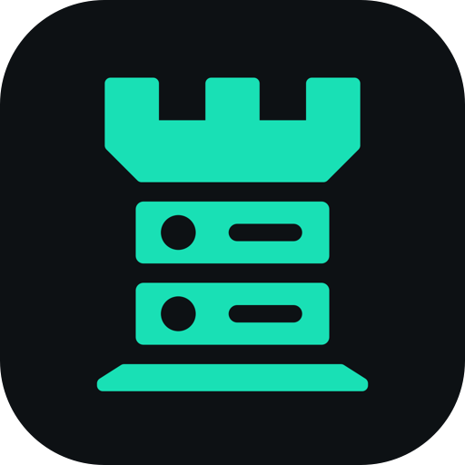
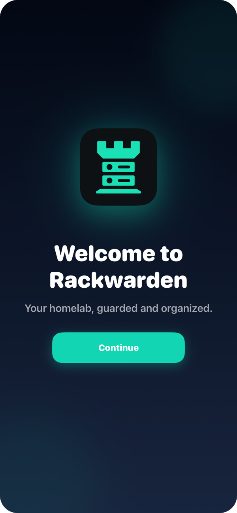
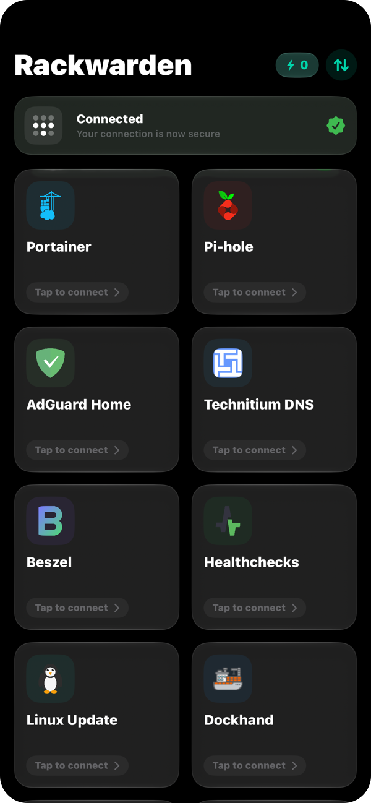
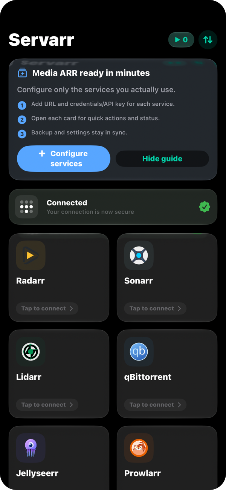
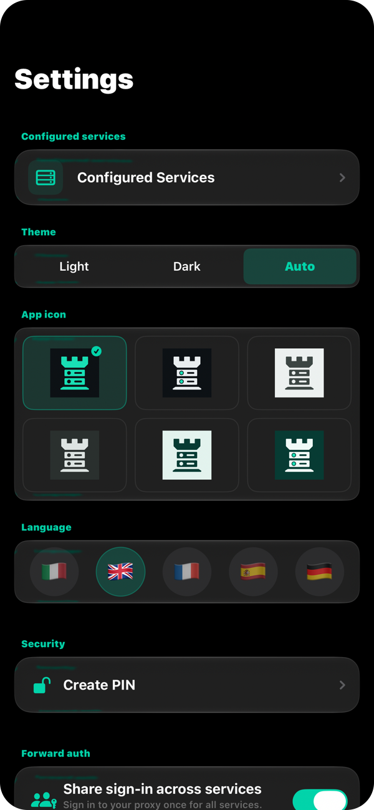
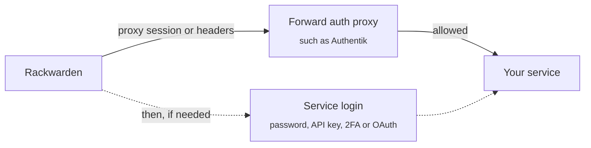

<div align="center">



# Rackwarden

**Your homelab, guarded and organized.**<br>
A native app to watch and manage your self-hosted services from one place,<br>
even when they sit behind a login proxy.

[](#ios)
[](#android)
[](HomelabSwift)
[](HomelabAndroid)
[](#services)
[](LICENSE)

<br>

<table>
<tr>
<td align="center"><br><sub><b>Welcome</b></sub></td>
<td align="center"><br><sub><b>Home</b></sub></td>
<td align="center"><br><sub><b>Servarr</b></sub></td>
<td align="center"><br><sub><b>Settings</b></sub></td>
</tr>
</table>

</div>

---

> [!NOTE]
> Rackwarden hasn't published a release yet, so for now you [build it from source](#install).
> Version 2.0.0 is coming to iOS first. The Android app and the project folders still use the Homelab name.

## Why

A homelab grows one web page at a time, and most of those pages weren't made for
a phone. Put them behind a proxy such as Authentik, add two-factor codes, and
simply checking whether everything is fine takes a dozen logins.

Rackwarden brings them together as native dashboards: what's online, what needs
attention, and the few actions you actually want on the go.

## Features

- **36 services in one app:** containers, storage, networking, media and
  monitoring. Add several instances of the same service and switch between them.
- **Works behind forward auth:** sign in to your proxy in the app or send
  custom headers, set per service. One sign-in can cover every service. ¹
- **Two-factor codes and OAuth:** one-time codes for services such as Nginx
  Proxy Manager, Beszel and Dockge, and OAuth sign-in for Beszel. ¹
- **Fallback addresses:** give a service a second URL, for example local and remote.
- **Locked down:** PIN and biometric unlock, with service credentials kept in
  the iOS Keychain.
- **Encrypted backups:** move your services to another device with a
  password-protected file.
- **Made to feel at home:** light and dark mode, alternate icons, and English,
  German, French, Italian and Spanish.
- **Beyond services:** bookmarks, plus a shortcut to Tailscale when you need it.

<sub>¹ iOS only for now.</sub>

## Services

### Infrastructure and monitoring

| | Service | What you get |
|:-:|---|---|
|  | **Portainer** | Containers, quick actions and resource usage |
|  | **Dockge ¹** | Compose stacks and services, agents, start, stop, restart and update |
|  | **Dockhand** | Container management |
|  | **DockMon** | Docker hosts and containers, logs, restart and update |
|  | **Komodo** | Resources, deployments, stacks and servers |
|  | **Proxmox VE** | Nodes, guests, storage, networking, backups and cluster operations |
|  | **TrueNAS SCALE / CORE** | Pools, disks, shares, services and alerts |
|  | **Scrutiny ¹** | Drive health, temperatures, S.M.A.R.T. attributes and archiving |
|  | **Beszel** | Server monitoring across nodes |
|  | **Uptime Kuma** | Monitor status and incidents |
|  | **Healthchecks** | Checks and health status |
|  | **Linux Update** | Pending package updates across hosts |
|  | **PatchMon** | Software updates across your stack |
|  | **Gitea / Forgejo** | Repositories, activity and source browsing |
|  | **Wakapi** | Coding activity and time tracking |
|  | **Crafty Controller** | Game server management |
|  | **Pterodactyl** | Game servers with power controls and live resources |
|  | **Calagopus** | Game servers with power controls, uptime and resources |

### Networking and DNS

| | Service | What you get |
|:-:|---|---|
|  | **Nginx Proxy Manager / NPMplus** | Proxy hosts, streams, redirects, certificates and access lists |
|  | **Pi-hole** | Queries, blocked domains, toggles and timers |
|  | **AdGuard Home** | Filters, rewrites, blocked services and query activity |
|  | **Technitium DNS** | DNS metrics and health |
|  | **Ubiquiti Network** | Gateways, switches, access points, clients and sites |
|  | **Pangolin / Newt** | Tunnels and peers |
|  | **Maltrail** | Threat detections and daily findings |

### Media and Servarr

| | Service | What you get |
|:-:|---|---|
|  | **Plex** | Libraries, sessions and recently added media |
|  | **Jellystat** | Jellyfin activity, streams and usage |
|  | **Sonarr** | TV library, queue, health and upcoming episodes |
|  | **Radarr** | Movie library, queue, health and upcoming releases |
|  | **Lidarr** | Music library, queue, health and upcoming releases |
|  | **Prowlarr** | Indexers, connected apps and issues |
|  | **Bazarr** | Subtitles, providers and issues |
|  | **Jellyseerr** | Requests and availability |
|  | **qBittorrent** | Transfers, speeds and connection status |
|  | **Gluetun** | VPN status, public IP and forwarded port |
|  | **FlareSolverr** | Sessions and status |

<sub>¹ iOS only for now, so Android has 34 services.</sub>

## Install

There are no downloads yet. Once released, builds will appear on the
[Releases page](https://github.com/milangtoth/Rackwarden/releases).

### iOS

You need a Mac with Xcode 26 or later and a device or simulator with iOS 26.

**1. Get the code**

```bash
git clone https://github.com/milangtoth/Rackwarden.git
cd Rackwarden
cp HomelabSwift/Config/Signing.xcconfig.example HomelabSwift/Config/Signing.xcconfig
```

**2. Set your signing details**

Put your own bundle ID and development team in `HomelabSwift/Config/Signing.xcconfig`.
Git ignores that file, so set them there rather than under **Signing & Capabilities**.

**3. Run it**

Open `HomelabSwift/Homelab.xcodeproj`, choose your device and press **⌘R**. With a
free Apple account, the app has to be reinstalled every 7 days.

### Android

Open `HomelabAndroid` in Android Studio, let Gradle sync, and run it on a device or
emulator with Android 8.0 or later.

## Usage

| | |
|---|---|
| **Add a service** | Tap its card, enter the address and sign in. |
| **Use a proxy login** | Turn on **Forward auth?** before signing in, then connect. |
| **Skip the service's own login** | Choose **No separate login**, where the service supports it. |
| **Sign in with OAuth** | Tap **Sign in with OAuth** (Beszel). |
| **Share one proxy sign-in** | **Settings → Forward auth**, on by default. |
| **Rearrange or hide services** | Tap **⇅** on Home or Servarr. |
| **Move to another device** | Export and import a backup in **Settings**. |

### Behind a login proxy



1. Turn on **Forward auth?** and sign in to the proxy in the app, or enter custom
   headers such as those for Cloudflare Access.
2. Rackwarden checks that the proxy lets it through, and only then asks for the
   service's own login.
3. When the proxy session expires, the card shows **Sign in**. Your service login
   is kept.

<details>
<summary><b>Good to know</b></summary>

- Password autofill is limited and passkeys may not work in the in-app sign-in page.
- How long you stay signed in depends on your proxy's session settings.
- The Proxmox console doesn't go through forward auth.
- For Beszel OAuth, add `rackwarden://oauth` to your provider's redirect URIs.

</details>

## Privacy and security

- **No account and no Rackwarden server.** The app talks to your services directly.
- **Few outside requests.** Service icons come from public icon hosts, some artwork
  and bookmark icons from third parties, and the update check from GitHub.
- **Proxy credentials stay put.** They're only sent to the address they belong to,
  never to another site after a redirect. Proxy sessions aren't included in backups.
- **Careful actions.** Archiving drives and stopping or updating Dockge stacks asks
  for confirmation first.

See the [privacy policy](docs/privacy.html) for details.

## Development

Build and test commands, branch conventions and release steps are in [AGENTS.md](AGENTS.md).
What changed in each version is in the [changelog](CHANGELOG.md).

<details>
<summary><b>Project layout</b></summary>

```
HomelabSwift/      iOS app (Swift 6, SwiftUI) and its tests
HomelabAndroid/    Android app (Kotlin, Jetpack Compose)
docs/              privacy and support pages
media-docs/        icons and screenshots
apps.json          AltStore Classic / SideStore source, filled by releases
app-version.json   version info for the in-app update check
```

</details>

## Contributing

Bug reports, compatibility issues and feature requests are welcome in
[GitHub Issues](https://github.com/milangtoth/Rackwarden/issues), and so are pull
requests. Please don't report Rackwarden issues to the original project.

## License

[Apache License 2.0](LICENSE), the same license as the original project. The
software is provided as is, without warranties.

## Acknowledgements

- Built on [Homelab Dashboard](https://github.com/JohnnWi/homelab-project) by
  [JohnnWi](https://github.com/JohnnWi), now archived, with contributions from
  [russssl](https://github.com/russssl), [FlintyLemming](https://github.com/FlintyLemming)
  and [vladtaylor](https://github.com/vladtaylor). The full commit history is preserved here.
- Service icons from [selfh.st/icons](https://selfh.st/icons/).

<sub>Rackwarden is an independent continuation and is not affiliated with or endorsed by the original author or the services it connects to. Product names and logos belong to their owners.</sub>
